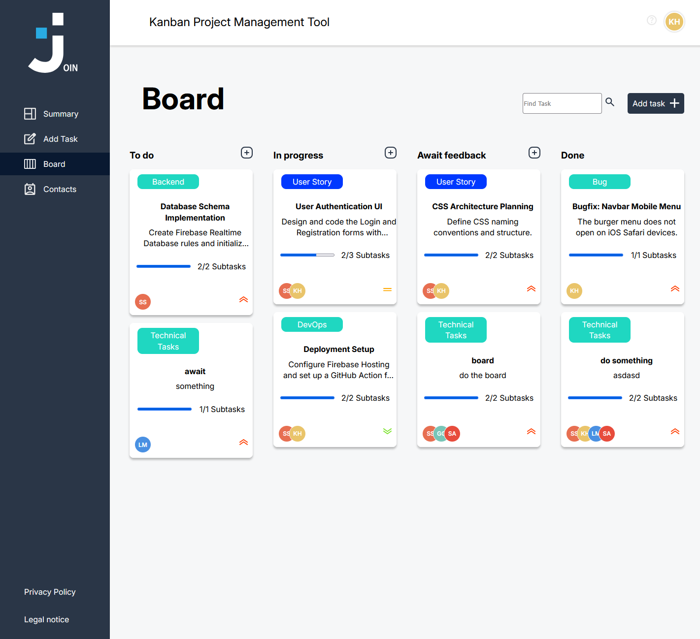

# Join

**Join** is a task management app that helps teams organize their work in one place. Create tasks, assign them to contacts, set priorities and due dates, and track progress on a visual Kanban board.
The board groups tasks into **To do**, **In progress**, **Await feedback**, and **Done** columns, making it easy to see what needs attention and how work is progressing. Join also includes a task summary, contact management, and account registration and login.

## What you can do with Join

- Sign up, log in, or use the guest login option
- Review an overview of tasks in the summary
- Create, edit, and organize tasks
- Set task details such as a title, description, category, priority, and due date
- Assign tasks to contacts
- Add subtasks to break larger tasks into smaller steps
- View tasks by their current status on the board
- Search for tasks
- Manage contacts

## Features

- Firebase Realtime Database integration
- Responsive layout
- Help, privacy policy, and legal notice pages

## Screenshot



## Tech stack

- HTML
- CSS
- JavaScript (ES modules)
- Firebase Realtime Database

## Getting started

### Run locally

1. Clone the repository:

   ```bash
   git clone https://github.com/KarloHlisc/join.git
   cd join
2. Open the project with a local development server, such as the Live Server extension in Visual Studio Code.
3. Open the local address provided by the server in your browser.

### Firebase configuration

The app connects to Firebase Realtime Database using the configuration in ```js/config.js```. To use your own Firebase project:

 1. Create a Firebase project and enable Realtime Database.
 2. Update the Firebase configuration in ```js/config.js``` with your project settings.
 3. Set up the database structure and access rules required by the app.


## Project structure

```
.
├── assets/
│   ├── fonts/
│   ├── icons/
│   └── img/
├── css/
│   ├── contact/
│   │   ├── contact_details.css
│   │   ├── contact_modal.css
│   │   └── contacts.css
│   ├── addTask1.css
│   ├── addTask2.css
│   ├── board.css
│   ├── help.css
│   ├── login.css
│   ├── policy_signup.css
│   ├── responsive.css
│   ├── signup.css
│   └── summary.css
├── html/
│   ├── add_task.html
│   ├── board.html
│   ├── contacts.html
│   ├── legal_after_login.html
│   ├── legal_login.html
│   ├── policy_after_login.html
│   ├── policy_login.html
│   ├── signup.html
│   └── summary.html
├── js/
│   ├── addtask/
│   │   ├── addtask_assign.js
│   │   ├── addtask_dropdown.js
│   │   ├── addtask_save.js
│   │   ├── addtask_subtask.js
│   │   └── addtask_validate.js
│   ├── board/
│   │   ├── addtask-board.js
│   │   └── edittask-board.js
│   ├── contacts/
│   │   └── contacts_validate.js
│   ├── addtask.js
│   ├── board.js
│   ├── board_2.js
│   ├── config.js
│   ├── contacts.js
│   ├── legal_policy_templates.js
│   ├── signup.js
│   ├── summary.js
│   ├── template.js
│   ├── template_board.js
│   ├── templates_login.js
│   └── utils.js
├── README.md
├── index.html
├── script.js
└── style.css
```

## Project creator

Built by **Sandro Spirg** and **Karlo Hlisc**.

## License

No license is specified in this repository.